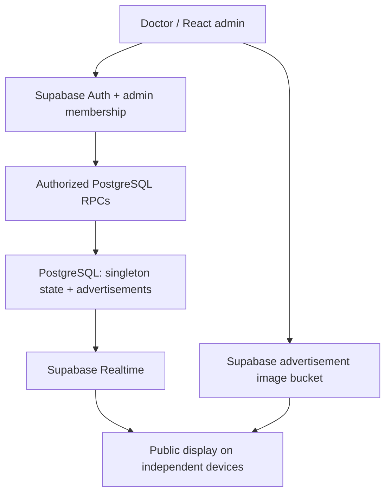

# පතිරාජ මන්තින්දාරාම විහාරය

සෙත් කවි කියවීම සඳහා පැමිණෙන බැතිමතුන්ගේ අංක සහ විහාරස්ථාන නිවේදන පෙන්වන පද්ධතියකි. පොදු තිරය, පරිපාලක පිවිසුම, සෙත් කවි කියවීමේ අංක පාලනය සහ නිවේදන කළමනාකරණය සිංහලෙන් භාවිත කළ හැක.

The interface is in Sinhala and uses the temple name පතිරාජ මන්තින්දාරාම විහාරය. Existing database/RPC names and routes remain compatible with the installed Supabase backend. In the technical setup instructions below, the original “doctor/admin” account means the authorized temple administrator; “advertisements” are temple notices. Existing notice text and images remain as entered by the administrator and can be edited into Sinhala from the notices page.

## Stack and architecture

React + TypeScript + Vite, Tailwind CSS, React Router, Lucide, React Hook Form and Zod. Supabase provides PostgreSQL, Auth, Storage and Realtime; there is no separate application server. Vercel serves the SPA.



The singleton row lock serializes all mutations. Appointment increments use server state, never a browser-calculated next number. Each advertisement mutation rebuilds an enabled-only public snapshot in the same transaction. Revisions prevent late responses from overwriting newer state. The display subscribes before fetching, refetches on subscription/reconnection and checks the backend every 15 seconds. Its last confirmed state remains visible during interruptions. Advertisement timers are independent of appointment updates.

## Project structure

```text
src/
  app/App.tsx                 Routes and lazy-loaded admin screens
  components/Modal.tsx        Native modal with focus restoration
  features/auth/             Session context and doctor login
  features/appointments/     Appointment controls
  features/advertisements/   List, editor, upload and preview
  features/display/          Public screen, state subscription and rotation
  layouts/AdminLayout.tsx    Shared header and navigation
  lib/                       Supabase, RPC/storage services, validation
  styles/globals.css         Responsive design and reduced-motion support
  types.ts                   Application record types
supabase/
  migrations/                Tables, RPCs, RLS, Storage and Realtime
  config.toml                Local backend configuration
tests/
  unit/                      Unit and React component tests
  integration/               Real database/auth/storage tests
  e2e/                       Playwright independent-browser tests
vercel.json                  Build settings, headers and SPA rewrites
```

## Local installation

Use Node 22.12+ or a compatible Node 24 release and npm. The lockfile fixes dependency versions.

```sh
npm install
cp .env.example .env
# Fill in the two VITE_ values.
npm run dev
```

On Windows PowerShell, use `Copy-Item .env.example .env`. If script execution blocks npm.ps1, use `npm.cmd` in place of `npm`. Open the URL printed by Vite. Without valid settings, the app shows a configuration screen, not fake data or a simulated queue.

```env
VITE_SUPABASE_URL=https://YOUR_PROJECT.supabase.co
VITE_SUPABASE_PUBLISHABLE_KEY=YOUR_BROWSER_SAFE_PUBLISHABLE_KEY
```

Only a publishable key (or legacy anon key) belongs in the frontend. Never provide a secret or service-role key. Vite embeds `VITE_` values during build; restart development or rebuild after changing them. `.env` files are ignored by Git.

## Supabase setup

### Temporary service closure notice

Apply **both** files in `supabase/migrations/` in filename order for a new project. For an existing installation, run only `20261113000200_service_availability.sql` in the Supabase SQL Editor. It adds an admin-only RPC and a persisted `service_paused` flag, defaulting to false. The existing Realtime subscription delivers this setting to all public screens.

On the number-control admin page, use **සෙත් කවි සේවාව තාවකාලිකව නවතා ඇත**. Enabling it replaces the public number and notices with **මේ දිනවල සෙත් කවි කියන්නේ නොමැති බව කරුණාවෙන් සලකන්න.** Disabling it restores the display without clearing the number or notices. This is a temporary service notice, not an HTTP 404. Admin login stays accessible. Until the migration is applied, the switch is disabled and shows a setup message.

1. Create a Supabase project. In its SQL editor run `supabase/migrations/20261113000100_clinic_display.sql`, or use the Supabase CLI: `supabase login`, `supabase link --project-ref YOUR_PROJECT_REF`, then `supabase db push`.
2. Configure the canonical storage URL with trusted SQL, **before uploading image advertisements**:

   ```sql
   update private.settings
   set storage_base_url = 'https://YOUR_PROJECT.supabase.co/storage/v1/object/public/advertisements'
   where id = true;
   ```

   For local Supabase the migration already uses `http://127.0.0.1:54321`. If using a custom API domain, set its corresponding storage URL. Do not add a trailing slash.

3. The migration initializes exactly one public row at 000 with no ads, enables RLS, creates the public `advertisements` bucket with JPEG/PNG/WebP and 5 MB limits, and adds `display_state` to `supabase_realtime`.
4. In Authentication settings disable new public signups. Configure your production Site URL. There is no public registration page.
5. Copy the project URL and publishable key into `.env` and later Vercel's environment settings.

For a local backend install the Supabase CLI and Docker, run `supabase start`, then `supabase db reset`. Local Studio is at `http://127.0.0.1:54323`. Seed data is intentionally empty and automatic seeding is disabled. The application does not require a backend for compilation or unit tests.

## Create the doctor account

In Supabase Dashboard → Authentication → Users, create the doctor's email/password user using the trusted dashboard. Confirm the email if needed. Copy the user's UUID, then run in the SQL editor:

```sql
insert into public.admin_users(user_id) values ('DOCTOR_AUTH_USER_UUID');
```

The browser cannot provision membership or read the admin list. Sign in at `/admin/login` and verify both admin routes. To revoke access, remove that row using trusted SQL; every mutation rechecks membership on the server. For immediate session removal, also revoke the user's sessions through Supabase administration.

## Usage

- TV: open `/` in browser fullscreen mode. Only the number, its labels and enabled ads are shown. Ads appear below the number. With no ads the number section fills the screen.
- Doctor: open `/admin/appointments`. Next Patient and Previous update atomically. Set Number accepts integers 0–9999. Reset asks for confirmation and returns to 000 without affecting ads. Nothing resets at midnight.
- Advertisements: open `/admin/advertisements`. Add text or image ads, edit, toggle, reorder, or confirm deletion. Duration is 3–120 seconds, default 10. Text is rendered as plain text. Image content is contained without cropping. An internal title is not included in public state.
- Open Display opens a separate tab. Any number of independent waiting-room screens may use the same public URL.

## Tests and build

The SQL tests included in `npm run test` run the real migration in embedded PostgreSQL with minimal Supabase schema stubs. They verify SQL logic but do not replace live Supabase tests. See [IMPLEMENTATION.md](IMPLEMENTATION.md) for actual verification results and remaining setup.

```sh
npm run lint
npm run typecheck
npm run test
npm run build
npm run preview
npx playwright install chromium
npm run test:e2e
npm run test:integration
```

`lint`, `typecheck`, `test`, `build` and `preview` need no live backend. Playwright starts Vite automatically; the configuration-screen test runs without credentials. Its live workflow and integration tests require a **disposable** Supabase project and accounts. They change the queue and create/delete advertisements. Do not run them against an active clinic.

Configure `.env.test` with the two `VITE_` variables and:

```env
TEST_SUPABASE_URL=http://127.0.0.1:54321
TEST_SUPABASE_PUBLISHABLE_KEY=YOUR_LOCAL_BROWSER_KEY
TEST_ADMIN_EMAIL=YOUR_TEST_ADMIN_EMAIL
TEST_ADMIN_PASSWORD=YOUR_TEST_ADMIN_PASSWORD
TEST_NONADMIN_EMAIL=YOUR_TEST_NONADMIN_EMAIL
TEST_NONADMIN_PASSWORD=YOUR_TEST_NONADMIN_PASSWORD
```

Create both test users via trusted administration, but grant `admin_users` membership only to the doctor. Live tests explicitly skip if required credentials are missing. Unit tests use mocks for focused behavior checks; they do not prove separate-device synchronization. Playwright's live test uses independent browser contexts and the real backend. Backend tests check concurrent increments, authorization, direct-write denial, validation, snapshots, CRUD and ordering.

## Vercel deployment

1. Push this folder's contents to your Git repository and import that repository into Vercel.
2. Select Vite, build command `npm run build`, output directory `dist`.
3. Set `VITE_SUPABASE_URL` and `VITE_SUPABASE_PUBLISHABLE_KEY` for the desired environments.
4. Apply the Supabase migration, configure the canonical storage URL, disable public signup and provision the doctor as above.
5. Deploy. `vercel.json` supplies SPA rewrites and security headers. Verify refresh/direct navigation at `/admin/appointments` and `/admin/advertisements`.
6. Open the HTTPS public URL on the TV and sign in from a separate device. Confirm both number changes and advertisement updates before clinic use.

No deployment credentials or backend settings are included in this repository.

## Security, image cleanup and troubleshooting

Public read access is limited to the singleton snapshot and public image URLs. Full advertisements are admin-readable; all browser table writes are denied. SECURITY DEFINER RPCs use an empty search path, qualified object names, revoked default execution and explicit admin checks. Internal helpers live in an unexposed private schema. Storage allows unique object creation and reference-checked deletion; overwrites are denied.

Disabled image ads remain accessible by their public URLs. Never upload patient records, personal information or sensitive images. Browser session persistence is used only for Supabase authentication; it is not queue synchronization.

Image replacement uploads a new UUID path, commits the record, and only then attempts old-file cleanup. Failed or uncertain saves deliberately retain uploaded files: deleting immediately after a timeout could break a committed advertisement. First refresh the admin list to reconcile the actual state. Storage deletion failures do not restore deleted advertisements.

To clean up orphans safely, pause image editing, wait for in-flight requests to settle, and inspect objects older than a suitable grace period (e.g. 24 hours) using trusted SQL:

```sql
select o.name, o.created_at
from storage.objects o
where o.bucket_id = 'advertisements'
  and o.created_at < now() - interval '24 hours'
  and not exists (select 1 from public.advertisements a where a.storage_path = o.name);
```

Review candidates and delete through the Storage API using an authenticated administrator so its reference-check policy applies. **Do not delete metadata with SQL**; that does not safely remove the underlying storage files. Never run an unreviewed service-role bulk deletion. The application does not automatically retry a mutation after ambiguous failure.

- Setup screen: verify environment values and rebuild/restart.
- Login denied: check credentials, email confirmation and exact UUID membership.
- Display stays on “Connecting”: verify migrations, public select policy, network and project URL.
- Reconnecting: verify `display_state` publication and WebSocket connectivity. Last confirmed content stays visible; polling and resubscription recover it. Admin mutations are disabled until the live connection returns.
- Images fail: check the canonical storage URL, MIME/size and object existence. Broken images show a bounded fallback and rotate normally.
- A save fails: refetch before retrying. It may have committed. Inspect backend logs privately; raw SQL errors are not shown to visitors.

Design references: [Supabase database functions](https://supabase.com/docs/guides/database/functions), [Postgres Changes](https://supabase.com/docs/guides/realtime/postgres-changes), [Vite setup](https://vite.dev/guide/).
